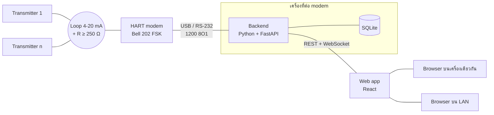
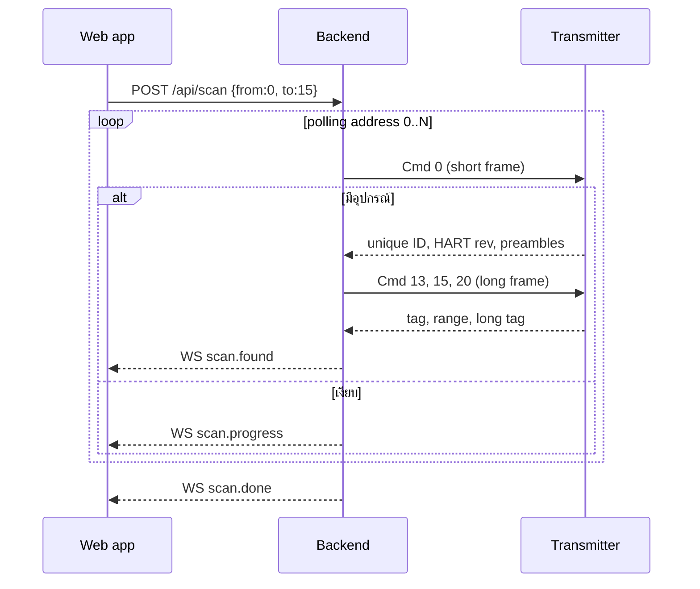
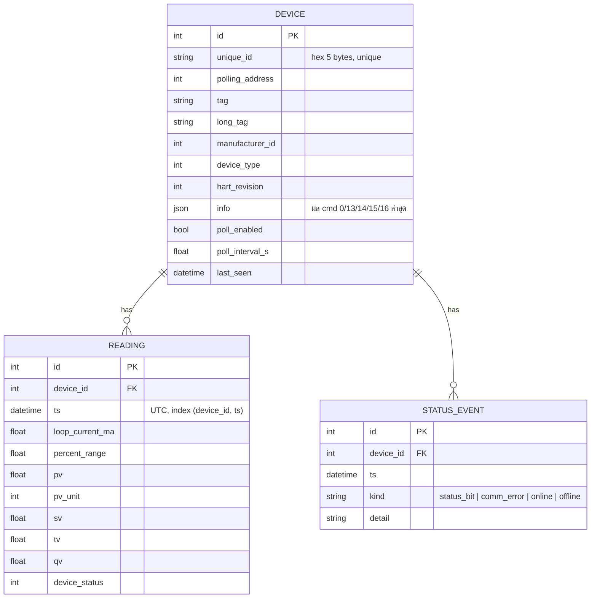

# DESIGN — HART Transmitter Reader

เอกสารออกแบบซอฟต์แวร์สำหรับอ่านค่าจาก transmitter ผ่าน HART protocol พร้อม web app
สถานะ: **v0.2 — Phase 0 และ 1 เสร็จกับ simulator แล้ว ยังไม่ได้ทดสอบกับ hardware จริง** (ดู §9)

---

## 1. เป้าหมายและขอบเขต

### เป้าหมาย
- ต่อ PC เข้ากับ loop 4–20 mA ผ่าน HART modem แล้วค้นหา (scan) transmitter ที่อยู่บน loop
- อ่านค่ากระบวนการ (PV/SV/TV/QV, loop current, % of range) แบบต่อเนื่อง
- อ่านข้อมูลประจำตัวอุปกรณ์ (tag, manufacturer, device type, range, damping ฯลฯ)
- แสดงสถานะและ diagnostic ของอุปกรณ์ (device status, additional status)
- ดูทั้งหมดผ่าน web app: ค่าสด, กราฟย้อนหลัง, export CSV

### ขอบเขต v1
| อยู่ในขอบเขต | อยู่นอกขอบเขต (ไว้ทีหลัง) |
|---|---|
| HART 5 / 6 / 7 แบบมีสาย (FSK, Bell 202) | WirelessHART |
| Universal commands + Common practice ที่เป็นการ **อ่าน** | คำสั่ง **เขียน** ทุกชนิด (re-range, trim, เปลี่ยน tag, fixed current) |
| Point-to-point และ multidrop | Device-specific commands / การอ่านไฟล์ DD/EDDL |
| Serial HART modem (USB/RS-232) | HART-IP (ออกแบบ interface เผื่อไว้ ทำใน phase 5) |
| ผู้ใช้คนเดียว/ทีมเล็กบน LAN | Multi-tenant, cloud, ระบบสิทธิ์ละเอียด |

> **เหตุผลที่ v1 เป็น read-only:** คำสั่งเขียนเปลี่ยนพฤติกรรมของ transmitter ที่อาจกำลังควบคุมกระบวนการจริง
> `Master` (จุดเดียวที่ส่ง byte ออก loop ได้) ตรวจ command number กับ allowlist ใน `hart/tables.py` ก่อนสร้าง frame เสมอ

---

## 2. ภาพรวมระบบ



**การตัดสินใจหลัก: backend ต้องรันบนเครื่องที่เสียบ modem**
Browser เข้าถึง serial port เองไม่ได้อย่างน่าเชื่อถือ (Web Serial API ใช้ได้เฉพาะ Chromium และคุม timing ของ HART ไม่ได้)
จึงให้ backend เป็นเจ้าของ serial port แต่เพียงผู้เดียว แล้ว browser คุยผ่าน HTTP/WebSocket

### Technology stack
| ส่วน | เลือกใช้ | เหตุผล |
|---|---|---|
| Backend | Python 3.12, FastAPI, uvicorn | asyncio เหมาะกับ polling + WebSocket, เขียน/ทดสอบ codec ง่าย |
| Serial | pyserial | รองรับ Windows/Linux, คุม RTS/parity ได้ |
| HART stack | **เขียนเอง** ใน `backend/hart/` | โปรโตคอลเล็ก, ต้องคุม timing/retry เอง, ไม่ผูกกับ library ที่ไม่มีคนดูแล |
| Database | SQLite (WAL) ผ่าน SQLAlchemy | ติดตั้งศูนย์, พอสำหรับไม่กี่ค่าต่อวินาที |
| Frontend | React + TypeScript + Vite | มาตรฐาน, build เป็น static ให้ FastAPI เสิร์ฟได้ |
| UI/กราฟ | Tailwind CSS, uPlot | uPlot เร็วกับ time series ยาว ๆ |
| ทดสอบ | pytest, Vitest, Playwright | |

---

## 3. สรุป HART protocol ที่ต้อง implement

> ค่า timing และ layout ด้านล่างสรุปจากความเข้าใจทั่วไปของ HART spec
> **ต้องตรวจกับเอกสาร FieldComm Group (HCF_SPEC-081, -127, -151) และทดสอบกับอุปกรณ์จริงก่อนถือว่าถูกต้อง**

### 3.1 Physical layer
- Bell 202 FSK ซ้อนบนสัญญาณ 4–20 mA: 1200 Hz = "1", 2200 Hz = "0"
- Serial: **1200 baud, 8 data bits, odd parity, 1 stop bit**
- Loop ต้องมีความต้านทานอย่างน้อย ~250 Ω มิฉะนั้นสัญญาณ HART จะหาย
- Half-duplex: modem ส่วนใหญ่ใช้ **RTS** เปิด carrier ตอนส่ง ต้องยก RTS ก่อนส่ง แล้วปล่อยทันทีที่ byte สุดท้ายออกครบ (ทำเป็น option เพราะ USB modem บางรุ่นจัดการเอง)

### 3.2 Frame

```
| Preamble | Delimiter | Address    | [Expansion] | Command | Byte count | Data      | Checksum |
| 5–20×FF  | 1 byte    | 1 หรือ 5 B | 0–3 B       | 1 B     | 1 B        | 0–255 B   | 1 B      |
```

- **Delimiter**: `0x02` STX short, `0x82` STX long (master→slave) · `0x06` / `0x86` ACK (slave→master) · `0x01` / `0x81` burst
- **Short address** (1 byte): bit7 = master (1 = primary), bit6 = burst, bit5–0 = polling address — ใช้กับ command 0 เท่านั้น
- **Long address** (5 bytes): bit7 = master, bit6 = burst, ตามด้วย unique ID 38 bit ที่ประกอบจาก manufacturer/device type และ device ID ที่ได้จาก command 0
- **Data ของ response** เริ่มด้วย 2 bytes เสมอ: `response code` + `device status`
- **Checksum**: XOR ทุก byte ตั้งแต่ delimiter ถึง byte สุดท้ายของ data
- ตัวเลข: big-endian, float เป็น IEEE 754 32-bit, `0x7FA00000` (NaN) = ค่าใช้ไม่ได้
- ข้อความ: Packed ASCII (6 bit/ตัวอักษร เช่น tag 8 ตัวอักษร = 6 bytes) และ ISO Latin-1 (long tag 32 bytes)

### 3.3 Response code และ device status
- byte แรก bit7 = 1 → **communication error** (bitmask: parity, overrun, framing, checksum, buffer overflow) ให้ retry
- byte แรก bit7 = 0 → **command response code** (0 = สำเร็จ, อื่น ๆ = error/warning เฉพาะคำสั่ง)
- byte ที่สอง **device status**:

| bit | ความหมาย | ระดับใน UI |
|---|---|---|
| 7 | Device malfunction | แดง |
| 6 | Configuration changed | ฟ้า (info) |
| 5 | Cold start | ฟ้า (info) |
| 4 | More status available → ไปอ่าน command 48 | เหลือง |
| 3 | Loop current fixed | เหลือง |
| 2 | Loop current saturated | เหลือง |
| 1 | Non-primary variable out of limits | เหลือง |
| 0 | Primary variable out of limits | เหลือง |

### 3.4 Commands ที่รองรับใน v1 (allowlist)

| Cmd | ชื่อ | ใช้ทำอะไร | Phase |
|---|---|---|---|
| 0 | Read Unique Identifier | scan, สร้าง long address, รู้ HART revision | 1 |
| 1 | Read Primary Variable | PV + หน่วย | 1 |
| 2 | Read Loop Current and Percent of Range | mA, % | 1 |
| 3 | Read Dynamic Variables and Loop Current | mA + PV/SV/TV/QV — **คำสั่งหลักของ polling** | 1 |
| 11 | Read Unique Identifier by Tag | ค้นหาด้วย tag | 2 |
| 12 | Read Message | ข้อความ 32 ตัวอักษร | 2 |
| 13 | Read Tag, Descriptor, Date | | 2 |
| 14 | Read PV Transducer Information | sensor limits, min span | 2 |
| 15 | Read Device Information | URV/LRV, damping, transfer function, write protect | 2 |
| 16 | Read Final Assembly Number | | 2 |
| 20 | Read Long Tag (HART 6+) | | 2 |
| 9 | Read Device Variables with Status (HART 6+) | ค่าพร้อม quality | 4 |
| 48 | Read Additional Device Status | diagnostic ละเอียด | 4 |

### 3.5 Timing และ master state machine
- 1 transaction ของ command 3 ใช้ราว **0.5 วินาที** ที่ 1200 bps (request ~14 bytes, response ~40 bytes, 11 bit/byte) → poll ได้ประมาณ 2 คำสั่ง/วินาที **รวมทั้ง loop**
- Response timeout ราว 300 ms นับจากส่ง byte สุดท้าย, retry 3 ครั้ง, แล้วจึงรายงาน `timeout` (ทุกค่าปรับได้ใน config)
- ทำงานเป็น **primary master** โดย default (เลือก secondary ได้ เผื่อมี DCS/handheld อยู่บน loop เดียวกัน)
- Preamble ตอนส่ง: เริ่มที่ 5 แล้วปรับตามค่าที่อุปกรณ์แจ้งใน command 0; ตอนรับยอมรับ ≥ 2
- ตัวรับต้อง resync ได้: ทิ้ง byte ขยะ, หา preamble → delimiter, ตรวจ checksum, และทิ้ง echo ของตัวเองถ้า modem สะท้อนกลับ
- **Bus lock**: ทั้ง process มี transaction พร้อมกันได้ครั้งละ 1 เท่านั้นต่อ 1 port (asyncio lock + priority queue: คำสั่งจากผู้ใช้แซงคิว polling ได้)

### 3.6 ลำดับการ scan



address 0 = point-to-point (ยังใช้ 4–20 mA), 1–15 (HART 5) หรือ 1–63 (HART 6+) = multidrop

---

## 4. สถาปัตยกรรมซอฟต์แวร์

### 4.1 Layer ของ backend

```
┌──────────────────────────────────────────────────────────────┐
│ api/        REST routes, WebSocket hub, schemas (pydantic)   │
├──────────────────────────────────────────────────────────────┤
│ services/   DeviceManager · Poller · Scanner · Recorder      │
├──────────────────────────────────────────────────────────────┤
│ hart/app    command definitions (encode request/decode reply)│
│ hart/link   frame codec · master state machine · retry       │
│ hart/transport   SerialTransport · SimulatorTransport · (IP) │
└──────────────────────────────────────────────────────────────┘
```

กฎของ layer: layer บนเรียก layer ล่างได้เท่านั้น · `hart/` ห้าม import FastAPI หรือ database
(ทำให้ทดสอบ stack ด้วย bytes ล้วน ๆ ได้ และนำไปใช้เป็น CLI/library ได้)

**Transport interface** — จุดเดียวที่แตะ hardware:
```python
class Transport(Protocol):
    async def open(self) -> None: ...
    async def close(self) -> None: ...
    async def write(self, data: bytes) -> None: ...      # จัดการ RTS ภายใน
    async def read(self, timeout: float) -> bytes: ...   # คืน bytes ที่มาถึงภายใน timeout
    async def drain_input(self) -> None: ...             # ทิ้ง bytes ค้างก่อนเริ่ม transaction
```

**Command definition** — 1 คำสั่ง = 1 class เล็ก ๆ ไม่มี I/O:
```python
class ReadDynamicVariables(Command[DynamicVariables]):
    number = 3
    def decode(self, payload: bytes) -> DynamicVariables: ...   # รับ response สั้นกว่า 24 bytes ได้
```

**Simulator** เป็น `Transport` อีกตัวหนึ่งที่จำลอง transmitter หลายตัว (ตอบ bytes จริงตาม frame format,
ใส่ noise/timeout/checksum ผิดได้) ใช้ทั้งตอนพัฒนา UI โดยไม่มี hardware และใน integration test

### 4.2 โครงสร้าง repository

```
.
├── CLAUDE.md                  คู่มือสำหรับ Claude Code
├── DESIGN.md                  เอกสารนี้
├── backend/
│   ├── pyproject.toml
│   ├── app/
│   │   ├── main.py            สร้าง FastAPI app, lifespan เปิด/ปิด port
│   │   ├── cli.py             hartcli: scan / read / monitor, dump frame
│   │   ├── config.py          settings (env + ไฟล์ config)
│   │   ├── hart/
│   │   │   ├── transport/     base.py, serial.py, simulator.py
│   │   │   ├── link/          frame.py, master.py, address.py
│   │   │   ├── app/           commands/, codec.py (float, packed ASCII), client.py (execute, identify, scan)
│   │   │   ├── tables.py      unit codes, manufacturer IDs, response codes
│   │   │   └── errors.py
│   │   ├── services/          device_manager.py, poller.py, scanner.py, recorder.py
│   │   ├── api/               routes/, ws.py, schemas.py
│   │   └── db/                models.py, session.py, migrations/
│   └── tests/
│       ├── unit/              codec, frame, commands (golden bytes)
│       ├── integration/       stack ทั้งชุดกับ simulator
│       └── fixtures/frames/   frame จริงที่จับจากอุปกรณ์ (.hex)
├── frontend/
│   ├── package.json
│   └── src/
│       ├── pages/             Dashboard, DeviceDetail, Scan, History, Settings
│       ├── components/        ValueCard, StatusBadges, TrendChart, RawFrameLog
│       ├── api/               client.ts (REST), socket.ts (WS + reconnect)
│       ├── stores/            สถานะอุปกรณ์/ค่าสด
│       └── types/             สร้างจาก OpenAPI ของ backend
└── docs/                      wiring, รายการ modem ที่ทดสอบแล้ว
```

### 4.3 Data model (SQLite)



- `READING` เก็บทุกรอบ poll; มี job ลบข้อมูลเก่ากว่า retention (default 90 วัน)
- `STATUS_EVENT` เก็บเฉพาะตอน **เปลี่ยนสถานะ** ไม่เก็บทุกรอบ

---

## 5. API

### 5.1 REST (`/api`)

| Method | Path | ทำอะไร |
|---|---|---|
| GET | `/ports` | รายการ serial port ที่เครื่องมองเห็น |
| GET / PUT | `/connection` | ดู/ตั้งค่า port, master role, preambles, retries, RTS mode; เปิด–ปิดการเชื่อมต่อ |
| POST | `/scan` | เริ่ม scan `{from, to}` → ผลลัพธ์ไหลมาทาง WebSocket |
| DELETE | `/scan` | ยกเลิก scan |
| GET | `/devices` | อุปกรณ์ทั้งหมด + ค่าล่าสุด |
| GET | `/devices/{id}` | รายละเอียดเต็ม |
| PATCH | `/devices/{id}` | `poll_enabled`, `poll_interval_s` (ตั้งค่าฝั่งซอฟต์แวร์เท่านั้น ไม่เขียนลงอุปกรณ์) |
| POST | `/devices/{id}/refresh` | อ่านข้อมูลประจำตัวใหม่ (cmd 0, 13–16, 20) |
| POST | `/devices/{id}/command` | ยิงคำสั่งเดี่ยวใน allowlist → คืนทั้งค่าที่ decode แล้วและ raw frame |
| GET | `/devices/{id}/readings` | `?from&to&max_points` (downsample ฝั่ง server) |
| GET | `/devices/{id}/readings.csv` | export |
| GET | `/devices/{id}/events` | ประวัติสถานะ |
| GET | `/health` | สถานะ port, คิว, สถิติ error |

Error ใช้รูปแบบเดียว: `{"error": {"code": "HART_TIMEOUT", "message": "...", "detail": {...}}}`
code หลัก: `PORT_NOT_OPEN`, `PORT_BUSY`, `HART_TIMEOUT`, `HART_COMM_ERROR`, `HART_RESPONSE_CODE`, `COMMAND_NOT_ALLOWED`

### 5.2 WebSocket (`/ws`)

Server → client, JSON ทุก message มี `type` และ `ts`:

```jsonc
{ "type": "reading", "ts": "2026-11-12T08:15:02.120Z", "device_id": 1,
  "loop_current_ma": 12.034, "percent_range": 50.21,
  "vars": [ { "name": "PV", "value": 25.10, "unit": "°C", "unit_code": 32 },
            { "name": "SV", "value": 24.87, "unit": "°C", "unit_code": 32 } ],
  "status": { "raw": 16, "flags": ["more_status_available"] } }

{ "type": "device.state", "device_id": 1, "state": "online" }   // online | offline | error
{ "type": "scan.progress", "address": 7, "of": 15 }
{ "type": "scan.found", "device": { /* เหมือน GET /devices/{id} */ } }
{ "type": "scan.done", "found": 2 }
{ "type": "frame", "dir": "tx", "hex": "FFFFFFFFFF82...", "device_id": 1 }  // เมื่อ subscribe เท่านั้น
{ "type": "connection", "state": "open", "port": "COM5" }
```

Client → server: `{"type":"subscribe","topics":["readings","frames"]}` — `frames` ปิดไว้เป็น default เพราะข้อมูลเยอะ

---

## 6. Web app

### 6.1 หน้าจอ

| หน้า | เนื้อหา |
|---|---|
| **Dashboard** | การ์ดต่ออุปกรณ์: tag, PV ตัวใหญ่ + หน่วย, แถบ % of range, mA, badge สถานะ, sparkline 5 นาที |
| **Device detail** | แท็บ *Live* (PV/SV/TV/QV + กราฟสด) · *Info* (ผล cmd 0/13/14/15/16/20) · *Diagnostics* (status bits, cmd 48, ประวัติ event) · *Raw* (ยิงคำสั่ง, ดู frame hex) |
| **Scan** | เลือกช่วง address, แถบความคืบหน้า, รายการที่พบ |
| **History** | เลือกอุปกรณ์/ตัวแปร/ช่วงเวลา, กราฟซูมได้, export CSV |
| **Settings** | serial port, master role, preambles, retries, RTS, retention, ภาษา |

```
┌ HART Reader ───────────── COM5 ● เชื่อมต่อแล้ว ─── [Scan] [ตั้งค่า] ┐
│                                                                    │
│ ┌ TT-101 ────────── ● ปกติ ┐  ┌ PT-205 ───── ▲ PV เกินช่วง ┐        │
│ │  25.10 °C                │  │  10.42 bar                │        │
│ │  ▓▓▓▓▓▓▓░░░░░░  50.2 %   │  │  ▓▓▓▓▓▓▓▓▓▓▓▓▓ 104.1 %    │        │
│ │  12.03 mA    ╱╲╱‾╲╱      │  │  20.66 mA     ╱‾‾‾‾‾      │        │
│ └ อัปเดต 1 วินาทีที่แล้ว ───┘  └ อัปเดต 1 วินาทีที่แล้ว ────┘        │
└────────────────────────────────────────────────────────────────────┘
```

### 6.2 หลักการ UI
- **ต้องเห็นเสมอว่าค่าสดหรือค้าง**: ทุกค่ามีเวลาที่อัปเดตล่าสุด; เกิน 3 เท่าของ poll interval → ทำสีจางและขึ้น "ข้อมูลค้าง"; ห้ามแสดงค่าเก่าเหมือนเป็นค่าปัจจุบัน
- สถานะใช้ทั้ง **สี + ไอคอน + ข้อความ** (ไม่พึ่งสีอย่างเดียว)
- ค่าที่อุปกรณ์ส่ง NaN แสดงเป็น "—" ไม่ใช่ 0
- UI ภาษาไทยเป็นหลัก สลับอังกฤษได้; ศัพท์ HART (PV, URV, LRV, tag) คงภาษาอังกฤษ
- WebSocket หลุด → แถบเตือนด้านบน + reconnect อัตโนมัติแบบ backoff
- ใช้บน tablet ได้ (responsive, ปุ่มใหญ่พอสำหรับนิ้ว)

---

## 7. ความปลอดภัยและการ deploy
- Default bind `127.0.0.1`; เปิดให้ LAN ต้องตั้งค่าเองและบังคับใส่ token (`Authorization: Bearer`) ทั้ง REST และ WS
- Command allowlist บังคับใน `hart/link/master.py` ไม่ใช่ที่ API → ไม่มีทางอ้อมผ่าน endpoint อื่น
- Deploy: build frontend เป็น static แล้วให้ FastAPI เสิร์ฟ → รันคำสั่งเดียว, port เดียว
- Config ผ่าน environment (`HART_PORT`, `HART_TRANSPORT=serial|simulator`, `HART_MASTER=primary|secondary`, `HART_DB_PATH`, `HART_BIND`, `HART_TOKEN`)

---

## 8. การทดสอบ

| ระดับ | ทดสอบอะไร | เครื่องมือ |
|---|---|---|
| Unit | float/packed ASCII/date codec, checksum, encode/decode frame, decode ทุก command จาก golden bytes, response สั้น/ยาวกว่าปกติ | pytest |
| Link | resync จาก byte ขยะ, echo, preamble สั้น, checksum ผิด → retry, timeout | pytest + fake transport |
| Integration | scan → poll → บันทึก DB → WS ส่งค่า โดยใช้ simulator | pytest + httpx |
| Frontend | components, store, การแสดงข้อมูลค้าง/NaN | Vitest |
| E2E | เปิดแอปกับ simulator: scan, เห็นค่าสด, export CSV | Playwright |
| Hardware | checklist ทำมือกับ modem + transmitter จริงอย่างน้อย 2 ยี่ห้อ (HART 5 และ 7) | docs/hardware-test.md |

Frame จริงที่จับได้จากอุปกรณ์เก็บเป็น fixture ใน `tests/fixtures/frames/` เพื่อกัน regression

---

## 9. แผนการทำงาน

| Phase | งาน | เสร็จเมื่อ (acceptance) |
|---|---|---|
| **0 — โครงโปรเจกต์** ✅ | สร้าง backend/frontend, lint, test runner, CI | `pytest` และ `npm test` ผ่านบน CI |
| **1 — HART core** ◐ | codec, frame, master state machine, cmd 0/1/2/3, SerialTransport, SimulatorTransport, `hartcli` | `hartcli scan` และ `hartcli read 3` ได้ค่าถูกจาก simulator **และ** จาก transmitter จริง 1 ตัว |
| **2 — Backend service** | cmd 11–16, 20, DeviceManager, Scanner, Poller, SQLite, REST + WS | integration test ผ่าน; poll ต่อเนื่อง 24 ชม. กับ simulator ไม่มี leak/ค้าง |
| **3 — Web app หลัก** | Dashboard, Scan, Device detail (Live/Info), Settings | ผู้ใช้เปิด browser → scan → เห็นค่าสดได้โดยไม่แตะ command line |
| **4 — History + Diagnostics** | กราฟย้อนหลัง, CSV, cmd 9/48, event log, raw frame viewer, retention | E2E ผ่าน; ดูย้อนหลัง 30 วันโหลดไม่เกิน 2 วินาที |
| **5 — เสริม** | HART-IP transport (UDP/TCP 5094), installer/Windows service, multidrop tuning | ตามลำดับความต้องการจริง |

**สถานะ Phase 1:** ผ่านกับ simulator ครบ (unit + integration test, `hartcli scan/read/monitor`)
**ยังค้าง: ทดสอบกับ modem และ transmitter จริง** — `SerialTransport` เขียนแล้วแต่ยังไม่เคยรันกับ hardware
priority queue ของ bus (§3.5) ยังเป็น lock ธรรมดา จะเพิ่มใน Phase 2 พร้อม Poller

ลำดับนี้ตั้งใจให้ **ความเสี่ยงสูงสุด (คุยกับ hardware จริง) ถูกพิสูจน์ใน Phase 1** ก่อนลงแรงกับ UI

---

## 10. ความเสี่ยงและคำถามที่ยังเปิด

| ความเสี่ยง | ผลกระทบ | วิธีรับมือ |
|---|---|---|
| Modem แต่ละรุ่นจัดการ RTS/echo ต่างกัน | ส่งไม่ออก หรืออ่านเจอ frame ตัวเอง | RTS mode ปรับได้ (`toggle`/`none`), ตัด echo ใน link layer, จดรุ่นที่ทดสอบแล้วใน docs |
| Timing ของ USB-serial ไม่แม่น (latency timer) | ปล่อย RTS ช้า ชนกับคำตอบ | รอให้ tx buffer ว่างก่อนปล่อย, แนะนำตั้ง latency 1 ms, มี timeout ที่ปรับได้ |
| มี master อื่นบน loop (DCS, handheld) | ชนกัน, timeout เป็นระยะ | เลือก secondary master ได้, retry + backoff, แสดงสถิติ error |
| Multidrop หลายตัวทำให้ refresh ช้า | 15 ตัว ≈ 8 วินาที/รอบ | แสดง refresh rate จริงใน UI, ตั้ง interval ต่ออุปกรณ์ได้ |
| รายละเอียด spec ที่สรุปไว้คลาดเคลื่อน | decode ผิด | ตรวจกับ spec ทางการ + fixture จากอุปกรณ์จริง |

**คำถามที่ต้องการคำตอบจากผู้ใช้ก่อนเริ่ม Phase 1**
1. ใช้ HART modem รุ่นอะไร และ transmitter ยี่ห้อ/รุ่นอะไรในการทดสอบ
2. เครื่องที่ต่อ modem เป็น Windows หรือ Linux (เช่น Raspberry Pi / industrial PC)
3. ใช้งานแบบ point-to-point ทีละตัว หรือ multidrop / ผ่าน HART multiplexer
4. ในอนาคตต้องการคำสั่งเขียน (re-range, เปลี่ยน tag, loop test) หรือไม่ — ถ้าต้องการจะมีผลต่อการออกแบบสิทธิ์และ audit log
